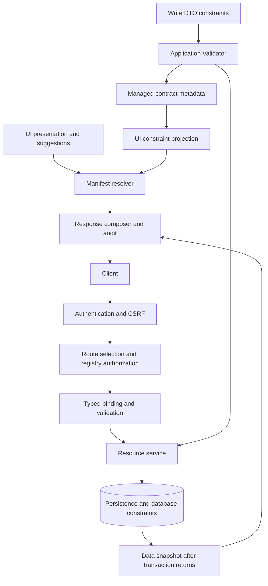

# Resource contracts and request flow

Resource definitions in `resource/tournament/` and `resource/season/` own request
contracts, supported standard actions, and operation permission predicates.
`ResourceRegistry` validates identity and uniqueness once. UI registrations reference
those exact registered definitions and add presentation, views, and relationships.
`@Resource` identifies a response DTO; its annotation alone never exposes routes.

## Validation and presentation

- Write DTOs own Bean Validation constraints. Composed constraints such as
  `@ResourceSlug` define rules once and allow attribute overrides per field.
- The managed `WriteContractMetadata` reads effective constraints from the same
  application Validator used at runtime. Its DTO metadata cache belongs to that
  component; production never creates a separate ValidatorFactory.
- The injected `UiConstraintProjector` and `UiManifestResolver` generate supported
  validation hints. Labels, option labels, references, widgets, layouts, and suggestions
  remain UI concerns. Presentation catalogues contain no authored validation rules.
- `WriteValidator` protects bound requests and direct service calls. Services enforce
  rules requiring stored state; database constraints protect concurrent writes.

Manifest `required` means a value is required after binding and defaults. It does
not require JSON property presence: tournament creates can omit `participantType`
and receive the DTO's `PLAYER` default, while updates must supply it.
`acceptsOmission` describes binding before validation: an omitted nullable season
`fromYear` binds to null and then fails `@NotNull`. Initial form values and projected
create defaults share the request DTO factory. Read/list manifests omit form hints.

`@WriteField` limits which operations can modify a request property. Other request
properties are writable by default; fields absent from the write contract are read-only.
Season updates use that same policy to compare `tournamentId` with persisted state
before mutation. Missing original state fails closed. Suggestions such as `SLUGIFY`
remain client assistance, so another valid value can be submitted. Constraints without
an explicit client translation continue to execute on the server.

## Routing, authorization, and responses

`ResourceCrudController` owns top-level list, detail, create/edit form, create, and
update routes. `ResourceAccess` identifies the registered operation for each generic
or specialised endpoint. Spring Security enforces authentication and CSRF;
`ResourceAuthorization` checks the selected route against registry permissions and
supported actions before argument conversion or JSON binding. There is no second
list of CRUD URL role rules. Unregistered resources and disabled actions cannot dispatch.
Delete remains unregistered. UI operations and commands also respect supported actions.

Typed resource handlers bind DTOs and delegate to services. Services return
`ResourceRecord` snapshots and DTO pages, materialised inside their transactions,
including any related-reference data needed for the response. They do not resolve
manifests, inspect UI permissions, or load published UI layouts.

`ResourceResponseComposer` builds response envelopes and attaches permission-controlled
audit data after service transactions return, when the Envers revision exists.
The manifest resolver applies published list layouts only to views that opt in.
Tournament creation retains its Location header; season creation retains its existing
response without one.

Resource-specific controllers retain lookups, season naming context, and existing
nested season routes. Nested CRUD delegates to the same handler and composer as
shallow routes, preserving parent scoping without repeating response orchestration.

## Remaining follow-ups

1. Version the resource catalogue to describe create/update constraints separately.
   Its current version exposes create constraints; form manifests already select the
   operation-specific contract. This changes the public contract and is deferred.
2. Add resource-owned domain problem translators as more resources are introduced.
   Shared exception advice currently handles the existing tournament and season errors.
